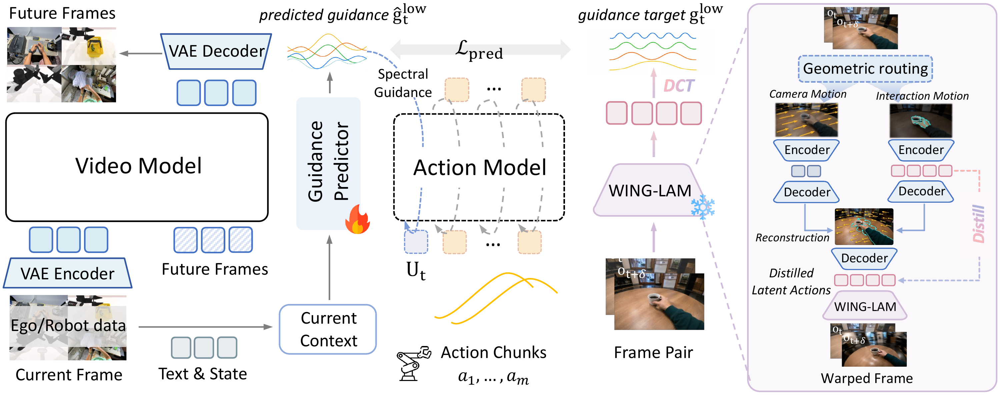

<div align="center">

<h1>WING: World Action Learning via<br>INteraction-Centric Spectral Latent Guidance</h1>

<p><b>From human experience to robot intelligence.</b></p>

<p>
  Zhiming Liu<sup>†</sup>, Yikun Miao<sup>†</sup>, Ying Chen<sup>†</sup>, Hongrui Yin, Fangqi Zhu,<br>
  Xiaoyi Pang, Quanxin Shou, Zhengyang Yan, Haodong Wang, Song Guo<sup>*</sup>
</p>

<p>The Hong Kong University of Science and Technology<br>
<sup>†</sup> Equal contribution &nbsp; <sup>*</sup> Corresponding author</p>

<p>
  <a href="https://mikuz12.github.io/wing/"></a>
  <a href="https://arxiv.org/abs/2610.03607"></a>
  <a href="#checkpoints"></a>
  <a href="#documentation"></a>
</p>

<p>
  <a href="https://www.python.org/"></a>
  <a href="https://pytorch.org/"></a>
  <a href="LICENSE"></a>
</p>

<p>
  <a href="#overview">Overview</a> ·
  <a href="#method">Method</a> ·
  <a href="#results">Results</a> ·
  <a href="#quick-start">Quick Start</a> ·
  <a href="#checkpoints">Checkpoints</a> ·
  <a href="#citation">Citation</a>
</p>

</div>

## Overview

**WING** transfers interaction knowledge from human videos to robot policies
through **interaction-centric latent actions** and **spectral latent guidance**.
This repository contains WING-LAM training and data preparation, robot-policy
training and evaluation for **LIBERO, RoboTwin 2.0, and RoboCasa–GR1**, and
real-robot deployment.

<p align="center">
  <a href="https://mikuz12.github.io/wing/#method"></a>
</p>
<p align="center"><em>WING learns interaction representations from human videos and predicts spectral guidance to generate robot action chunks.</em></p>

## Method

**1. Learn interaction-centric latent actions.** WING-LAM separates camera
motion from interaction motion using geometric routing, then distills the
interaction representation into an RGB-only student. The student extracts
latent actions from frame pairs without requiring trackers or hand masks.

**2. Transfer shared temporal structure.** A temporal discrete cosine transform
(DCT) turns latent trajectories into spectral targets. The released policy uses
**Full-K4 spectral guidance**: an eight-step, 32-dimensional latent trajectory,
retaining the four low-frequency coefficients K0–K3.

**3. Guide robot action generation.** At inference, the policy predicts the
spectral coefficients from current observations, language, and robot state,
then uses them to guide action generation. Future frames are used to construct
training targets; they are not needed at inference.

See the [project page](https://mikuz12.github.io/wing/#method) for the method
animation and the [WING-LAM guide](docs/lam.md) for training and distillation.

## Results

Average success rates reported in the paper:

| Benchmark | Setting | Average success |
| --- | --- | --- |
| **LIBERO** | Four-suite average | **99.20%** |
| **RoboTwin 2.0** | Clean and randomized average | **93.80%** |
| **RoboCasa–GR1** | 24-task tabletop average | **57.7%** |

These are paper results, not measurements from the environment checks in this
repository. See the [project page](https://mikuz12.github.io/wing/) for comparisons
and videos. Released checkpoint-to-result mappings are pending.

## Release Status

- [x] WING-LAM teacher training, RGB student distillation, and data preparation
- [x] Robot-policy training and evaluation for LIBERO, RoboTwin 2.0, and RoboCasa–GR1
- [x] Real-robot deployment code and documentation
- [ ] Public checkpoint download links and checkpoint-to-result mappings

> **Weights and data:** Checkpoint links are currently publication placeholders.
> Stage-II training requires a Stage-I planner checkpoint; the Stage-I
> human-video training recipe and dataset are not included. Simulators,
> datasets, and pretrained weights must be obtained separately.

## Quick Start

Run commands from the repository root on Linux. The following creates the policy
environment; simulator and robot environments are configured separately.

```bash
git clone https://github.com/MIKUZ12/WING_code.git
cd WING_code

conda env create -f environment.yml
conda activate wing
python -m pip install torch==2.7.1 torchvision==0.22.1 --index-url https://download.pytorch.org/whl/cu128
python -m pip install -e '.[train,data,test]'
python -m pip check
python scripts/check_environment.py --video
```

The last command checks imports, the Full-K4 forward/backward path, and CPU video
decoding without downloading weights. A successful check ends with
`Environment check passed.`

<details>
<summary><b>GPU environment checks and installation alternatives</b></summary>

Check the training/GPU environment separately:

```bash
python scripts/check_environment.py --training --video --require-cuda
```

Follow [installation and troubleshooting](docs/installation.md) for a `venv`
alternative, CUDA/compiler requirements, and model-cache setup. See
[tested environment and resource planning](docs/environment.md) for the scope of
verification and the distributed training settings.

</details>

### Prepare assets and train

Once checkpoints and data are available:

1. Prepare the assets in the [checkpoint guide](docs/checkpoints.md).
2. Build dataset statistics, text/VAE caches, and WING-LAM targets using the
   matching benchmark guide below.
3. Train or evaluate with the matching task, camera layout, action dimension,
   and normalization statistics.

For example, after completing the [LIBERO preparation](docs/libero.md):

```bash
export PHASE1_SPECTRAL_CHECKPOINT="$PWD/checkpoints/wing_stage1.pt"
export ACTION_DIT_CHECKPOINT="$PWD/artifacts/checkpoints/action_dit_libero.pt"
NUM_GPUS=8 bash scripts/train.sh task=libero \
  data.train.base_dataset.vae_latent_cache_required=true \
  output_dir=artifacts/runs/libero_full_k4
```

## Checkpoints

The download fields are explicit publication placeholders, not working URLs.
Replace each `TODO` with its public download link when the asset is released.

| Asset | Download placeholder | Used for |
| --- | --- | --- |
| WING Stage-I planner | `TODO: WING_STAGE1_URL` | Initializing Stage-II policy training |
| WING-LAM teacher | `TODO: WING_LAM_TEACHER_URL` | Student distillation and motion decoding |
| WING-LAM RGB student | `TODO: WING_LAM_STUDENT_URL` | Extracting spectral training targets |
| WING LIBERO policy bundle | `TODO: WING_LIBERO_URL` | LIBERO evaluation |
| WING RoboTwin policy bundle | `TODO: WING_ROBOTWIN_URL` | RoboTwin evaluation |
| WING RoboCasa policy bundle | `TODO: WING_ROBOCASA_URL` | RoboCasa evaluation |
| WING real-robot policy bundle | `TODO: WING_REAL_ROBOT_URL` | Matching hardware deployment |

Each policy bundle must include its resolved training config, dataset
normalization JSON, spectral normalization statistics, and camera/action
specification. The Wan backbone and source LAM checkpoint are separate assets.
See [asset layout and loading requirements](docs/checkpoints.md).

## Documentation

| Guide | Contents |
| --- | --- |
| [Installation](docs/installation.md) | Conda/venv setup, CUDA, video decoding, troubleshooting |
| [Environment and resources](docs/environment.md) | Verified software, hardware planning, test limits |
| [Checkpoints](docs/checkpoints.md) | Download placeholders, asset layout, metadata requirements |
| [Configuration](docs/configuration.md) | Model, data, and task configuration |
| [Policy training](docs/training.md) | WING-LAM assets, Stage-I initialization, resume |
| [LIBERO](docs/libero.md) | Data preparation, training, evaluation |
| [RoboTwin 2.0](docs/robotwin.md) | Data conversion, caches, training, evaluation |
| [RoboCasa–GR1](docs/robocasa.md) | 24-task preparation, training, remote evaluation |
| [WING-LAM](docs/lam.md) | Tracks/masks, teacher training, RGB distillation |
| [Real robots](docs/real_robot.md) | Policy server, ROS/Piper integration, motion checks |

## Feedback and Contributions

Use the repository's Issues tab for bugs and reproduction questions. Include
the command, task/config overrides, package versions, and relevant traceback.
Remove credentials, private paths, and data before sharing logs or configs.
For a fix, submit a pull request describing the behavior change and validation.

## Citation

```bibtex
@misc{liu2026worldactionlearninginteractioncentric,
  title={World Action Learning via Interaction-Centric Spectral Latent Guidance},
  author={Zhiming Liu and Yikun Miao and Ying Chen and Hongrui Yin and Fangqi Zhu and Xiaoyi Pang and Quanxin Shou and Zhengyang Yan and Haodong Wang and Song Guo},
  year={2026},
  eprint={2610.03607},
  archivePrefix={arXiv},
  primaryClass={cs.RO},
  url={https://arxiv.org/abs/2610.03607}
}
```

## License

WING source is released under the [MIT License](LICENSE), with the third-party
exceptions stated there. Embedded source retains its notices; see
[third-party code and dependencies](docs/third_party.md). External datasets,
weights, simulators, and hardware SDKs follow their own terms.
